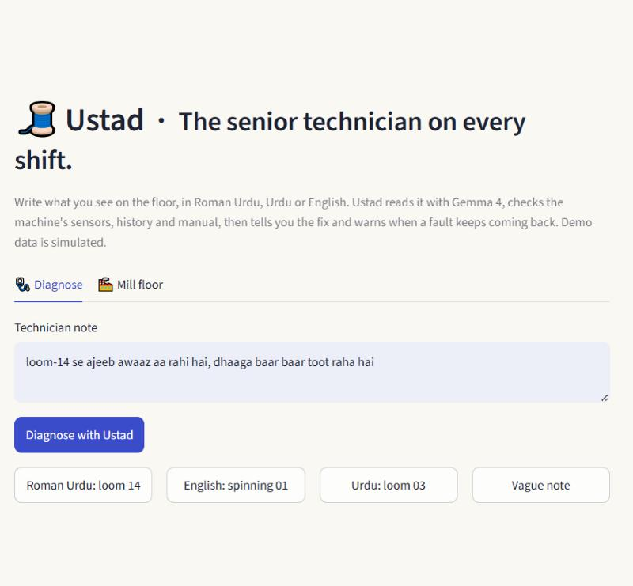
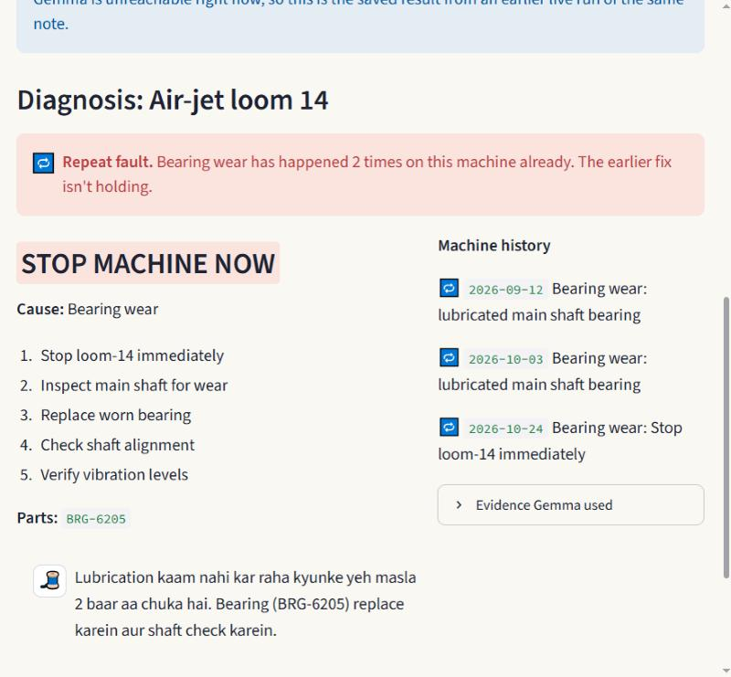
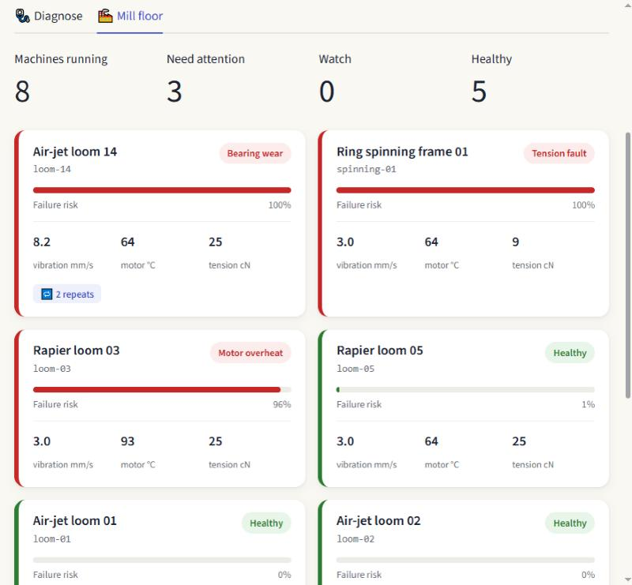
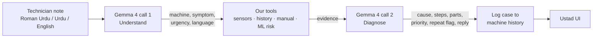

# 🧵 Ustad

**The senior technician on every shift.** (*Ustad* is Urdu for master craftsman.)

Ustad is a maintenance copilot for textile mills, built around **Gemma 4**. A floor technician writes what they see, in Roman Urdu, Urdu or English. Ustad works out which machine it is, checks that machine's sensors, history and manual, then gives the fix and warns when the same fault keeps coming back.

Built at **Hacktoberfest Karachi 2026 Hack Day** · **Harness track** · MIT licence.

---

## The problem
Every mill has one *ustad* who knows why loom 14 keeps breaking. When they are off shift, that knowledge is gone:
- Technicians write quick notes like *"loom-14 se ajeeb awaaz aa rahi hai, dhaaga toot raha hai"* and then lose time finding the cause.
- Nobody checks the machine's history, so the same quick fix (lubricate the bearing) is repeated until the machine breaks down and production stops.

## What Ustad does
1. Reads a messy note in the technician's own language.
2. Pulls the evidence for that machine: live sensors, maintenance history, manual section, failure-risk model.
3. Diagnoses: cause, repair steps, part numbers, priority.
4. **Flags repeat faults**: "bearing wear has happened 2 times already, the earlier fix isn't holding, replace the part."
5. Replies in the technician's language and logs the case, so the next repeat is caught.

## Screenshots
| Diagnose | Diagnosis (Gemma 4 output) | Mill floor |
|---|---|---|
|  |  |  |
| Technician types or picks a note. | Repeat-fault alert, STOP MACHINE NOW, part BRG-6205, reply in Roman Urdu. | Every machine's health; loom-14 shows 🔁 2 repeats. |

The diagnosis screenshot shows Gemma 4's answer from a live run. The venue network was dropping connections, so the app displayed it from its demo cache (it says so in a blue banner; see [Reliability](#reliability)).

---

## Harness and skill: what is what
The event has two tracks. **Ustad is a Harness-track project.** It also ships the same job as a skill, so it can be used without code.

| | What it is | Where |
|---|---|---|
| **Harness** (our entry) | Python code around Gemma 4 that runs a fixed 4-step loop, calls our own tools between the two Gemma calls, checks the output, and logs the result. | `harness.py`, `llm.py`, tools in `data.py` / `ml.py`, UI in `app.py` |
| **Skill** (bonus, no code) | The same procedure written as plain-English instructions. Paste it into Google AI Studio with Gemma 4 31B and it does the diagnosis by hand. | [`skill/SKILL.md`](skill/SKILL.md) |

### How the harness works


| Step | Who does it | Detail |
|---|---|---|
| 1. Understand | **Gemma 4** | Extracts `machine_id`, `symptom`, `urgency`, `language` as JSON from the note. If no machine is named, Ustad asks instead of guessing. |
| 2. Gather evidence | **Our code** | `get sensors`, `get history`, `search manual`, and a scikit-learn failure-risk model (`ml.py`). Counts how often this fault has already happened. |
| 3. Diagnose | **Gemma 4** | Reasons over the note + evidence. Returns `cause`, `steps`, `parts`, `priority`, `repeat_pattern`, and a `reply` in the technician's language. Told to use only the evidence (no invented part numbers). |
| 4. Remember | **Our code** | Appends the case to the machine's history, so the next repeat is detected. |

**Gemma 4 does the language understanding and the diagnosis.** The code around it decides what evidence Gemma sees, validates its JSON (with one repair retry), and keeps the history.

Model: `gemma-4-31b-it`, called through OpenRouter (`google/gemma-4-31b-it:free`), with Google AI Studio's Gemini API as fallback (`llm.py`). Gemma is open-weight, so a mill could run Ustad on its own computer and keep machine data in the factory.

### Reliability
- Retries on API errors, then falls back to the second provider.
- If Gemma is unreachable during a demo, the app shows the last good live result for the same note, clearly labelled as cached (`demo_cache.json`).
- If Gemma returns malformed JSON, it is asked once to return only JSON.

---

## Data (simulated)
No public textile-machine fault dataset exists, so the demo mill is simulated in `data.py`:
- 8 machines (6 looms, 2 ring spinning frames), one live sensor snapshot each
- maintenance history: loom-14 has had bearing wear twice, fixed only by lubrication
- 4 manual excerpts with part numbers
- the failure-risk model trains in about a second on 6,000 generated rows

**Next step:** connect real sensor feeds, the mill's maintenance (CMMS) history and OEM manuals. The harness does not change; only the tools do.

## Run it
```
python -m pip install -r requirements.txt
$env:OPENROUTER_API_KEY="..."   # and/or $env:GEMINI_API_KEY="..."
python -m streamlit run app.py
```
Try the example buttons: **Roman Urdu: loom 14** shows the repeat-fault alert, **Vague note** shows Ustad asking which machine.

Restart the app to reset the simulated history (each run logs a case).

## Tests
`python check.py` runs 8 offline checks (Gemma faked): JSON parsing, unknown machine, Gemma down, bad model output, healthy machine not blamed, steps reported in order.
`python check.py live` calls Gemma for real.

## Files
| File | Purpose |
|---|---|
| `app.py` | Streamlit UI: Diagnose tab, Mill floor tab |
| `harness.py` | The 4-step loop and prompts |
| `llm.py` | Gemma 4 client (OpenRouter, Google fallback, retries) |
| `data.py` | Simulated machines, sensors, history, manual |
| `ml.py` | Failure-risk model (tool) |
| `floor.py` | Mill floor dashboard |
| `skill/SKILL.md` | The same job as a no-code skill |
| `docs/` | Design spec, plan, screenshots |

## License
MIT
